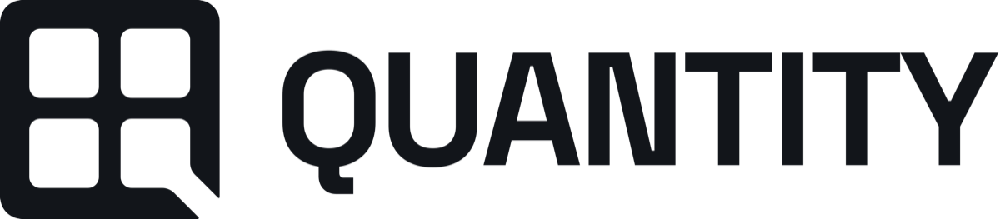

<picture>
  <source media="(prefers-color-scheme: dark)" srcset="./assets/quantity-banner-dark.png">
  <source media="(prefers-color-scheme: light)" srcset="./assets/quantity-banner-light.png">
  
</picture>

**A self-hosted application platform.** One control plane to provision, isolate and operate backend environments.

Every project on Quantity gets an isolated runtime of its own:

- **PostgreSQL** as the foundation, with managed roles, extensions and schema lifecycle
- **Authentication** for identities, sessions and tokens
- **Data API** with row-level security
- **Storage** for buckets and objects
- **Realtime** channels, broadcast and presence
- **Functions** with bounded, isolated execution

Quantity is in active development. Its repositories are private.
